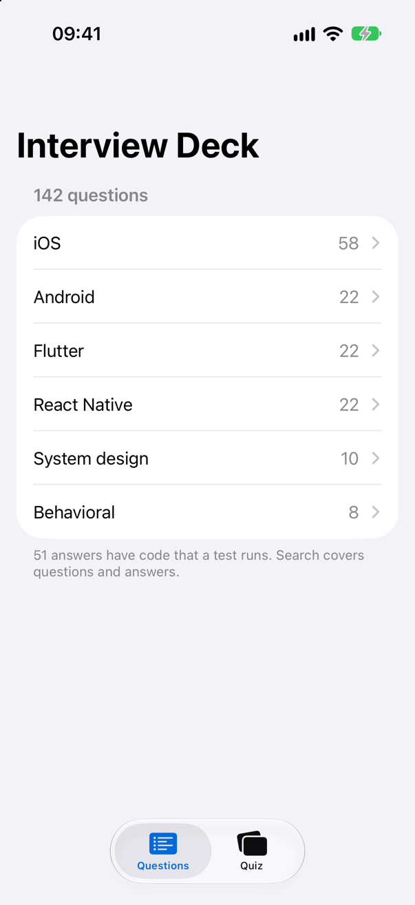
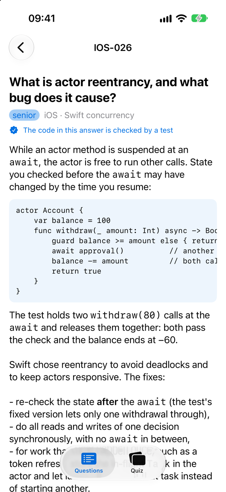
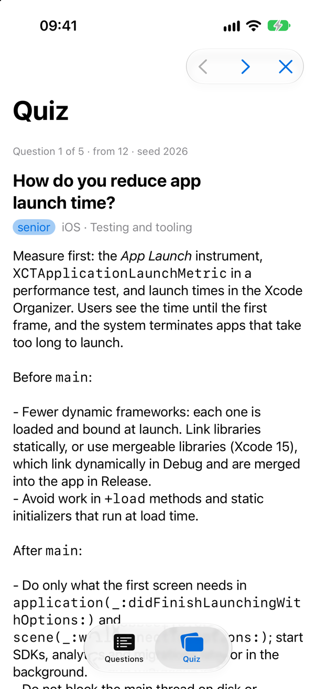

<!-- i18n-source: README.md@1616d72d635be23227644c65d518040fd9e862bc status=reviewed -->
<!-- brand:start -->

<p align="center"><picture><source media="(prefers-color-scheme: dark)" srcset="https://raw.githubusercontent.com/muhittincamdali/mobile-interview-questions/main/.github/brand/banner-dark.svg"><source media="(prefers-color-scheme: light)" srcset="https://raw.githubusercontent.com/muhittincamdali/mobile-interview-questions/main/.github/brand/banner-light.svg"></picture></p>

<!-- lang-selector:start -->
<p align="center"><a href="README.md">English</a> · <a href="README.tr.md">Türkçe</a> · <a href="README.zh-CN.md">简体中文</a> · <a href="README.ja.md">日本語</a> · <a href="README.ko.md">한국어</a> · <a href="README.es.md">Español</a> · <a href="README.de.md">Deutsch</a> · <a href="README.fr.md">Français</a> · <a href="README.pt-BR.md">Português (Brasil)</a> · <a href="README.ru.md">Русский</a></p>
<!-- lang-selector:end -->

<p align="center">
<a href="https://github.com/muhittincamdali/mobile-interview-questions/actions/workflows/ci.yml"></a>
<a href="https://github.com/muhittincamdali/mobile-interview-questions/releases"><picture><source media="(prefers-color-scheme: dark)" srcset="https://raw.githubusercontent.com/muhittincamdali/mobile-interview-questions/main/.github/brand/badge-version-dark.svg"><source media="(prefers-color-scheme: light)" srcset="https://raw.githubusercontent.com/muhittincamdali/mobile-interview-questions/main/.github/brand/badge-version-light.svg"></picture></a>
<a href="https://github.com/muhittincamdali/mobile-interview-questions/blob/main/Package.swift"><picture><source media="(prefers-color-scheme: dark)" srcset="https://raw.githubusercontent.com/muhittincamdali/mobile-interview-questions/main/.github/brand/badge-platforms-dark.svg"><source media="(prefers-color-scheme: light)" srcset="https://raw.githubusercontent.com/muhittincamdali/mobile-interview-questions/main/.github/brand/badge-platforms-light.svg"></picture></a>
<a href="https://github.com/muhittincamdali/mobile-interview-questions/blob/main/Package.swift"><picture><source media="(prefers-color-scheme: dark)" srcset="https://raw.githubusercontent.com/muhittincamdali/mobile-interview-questions/main/.github/brand/badge-language-dark.svg"><source media="(prefers-color-scheme: light)" srcset="https://raw.githubusercontent.com/muhittincamdali/mobile-interview-questions/main/.github/brand/badge-language-light.svg"></picture></a>
<a href="https://github.com/muhittincamdali/mobile-interview-questions/blob/main/LICENSE"><picture><source media="(prefers-color-scheme: dark)" srcset="https://raw.githubusercontent.com/muhittincamdali/mobile-interview-questions/main/.github/brand/badge-license-dark.svg"><source media="(prefers-color-scheme: light)" srcset="https://raw.githubusercontent.com/muhittincamdali/mobile-interview-questions/main/.github/brand/badge-license-light.svg"></picture></a>
</p>

<p align="center">
<a href="#快速开始"><picture><source media="(prefers-color-scheme: dark)" srcset="https://raw.githubusercontent.com/muhittincamdali/mobile-interview-questions/main/.github/brand/button-start-zh-CN-dark.svg"><source media="(prefers-color-scheme: light)" srcset="https://raw.githubusercontent.com/muhittincamdali/mobile-interview-questions/main/.github/brand/button-start-zh-CN-light.svg"></picture></a>
<a href="https://muhittincamdali.github.io/mobile-interview-questions/documentation/interviewbank/"><picture><source media="(prefers-color-scheme: dark)" srcset="https://raw.githubusercontent.com/muhittincamdali/mobile-interview-questions/main/.github/brand/button-docs-zh-CN-dark.svg"><source media="(prefers-color-scheme: light)" srcset="https://raw.githubusercontent.com/muhittincamdali/mobile-interview-questions/main/.github/brand/button-docs-zh-CN-light.svg"></picture></a>
<a href="https://github.com/muhittincamdali/mobile-interview-questions/tree/main/Examples"><picture><source media="(prefers-color-scheme: dark)" srcset="https://raw.githubusercontent.com/muhittincamdali/mobile-interview-questions/main/.github/brand/button-examples-zh-CN-dark.svg"><source media="(prefers-color-scheme: light)" srcset="https://raw.githubusercontent.com/muhittincamdali/mobile-interview-questions/main/.github/brand/button-examples-zh-CN-light.svg"></picture></a>
</p>

> 本文是英文 README 的译文。如两者内容不一致，以英文版为准。

<!-- brand:end -->
面向移动开发者的面试题与答案，涵盖 iOS、Android、Flutter、React Native、移动端系统设计和行为面试。题库共有 142 道题，每道题都标注了 junior、mid 或 senior 级别，每个技术类答案都链接到它所依据的一手资料：Apple、Android、Flutter、Dart、Kotlin 和 React Native 的官方文档、Swift Evolution 提案、MDN 或 RFC。其中 51 个答案附带代码，由 CI 中的测试实际运行，因此答案里的论断（actor 是可重入的，`Int(Double.nan)` 会 trap，const widget 不会被重建，`forEach` 不会 await）都经过验证，而不是简单转述。

你可以直接在 GitHub 上阅读题目，用 `interview` 命令在终端里自测，也可以在适用于 iPhone、iPad 和 Mac 的 InterviewDeck 应用中学习。

## 亮点

- **当前平台** — 默认 main-actor isolation 与 `@concurrent` 的 Swift 6 语言模式、使用 iOS 27 SDK 构建的应用必须采用的 scene 生命周期、Android 16 的大屏和 predictive-back 变化、Dart 3 的 pattern 与 extension type，以及 React Native New Architecture。
- **可以自行核实的答案** — 每个技术类答案都引用一手资料，没有引用的答案会被 linter 拒绝。
- **经过测试的代码** — Swift 答案在 macOS 和 iPhone 模拟器上用 Swift Testing 运行，Dart 和 Flutter 答案用 `flutter test` 运行（包括 widget 测试），JavaScript 答案用 `node --test` 运行。每个测试都以它所检验的题目命名。
- **学习工具** — `swift run interview quiz` 按方向和级别随机抽题；使用相同的 seed，在任何机器上都能重现同一套测验。
- **统一格式，经过 lint** — 题目是结构固定的纯 Markdown 文件，同一批文件同时服务于 GitHub、命令行、应用和 [InterviewBank](#使用库) 库。

### 题库内容

| 方向                                   | 主题                                                                          | 题数 | 含经过测试的代码 |
| -------------------------------------- | ----------------------------------------------------------------------------- | ---: | ---------------: |
| [iOS](questions/ios)                   | Swift 语言、内存、并发、SwiftUI、UIKit 与应用生命周期、数据与网络、测试与工具 |   58 |               26 |
| [Android](questions/android)           | Kotlin 与协程、Android 框架与 Jetpack                                         |   22 |                — |
| [Flutter](questions/flutter)           | Dart 语言、Flutter 框架                                                       |   22 |               14 |
| [React Native](questions/react-native) | 面向 React Native 的 JavaScript、React Native                                 |   22 |               11 |
| [系统设计](questions/system-design)    | 离线同步、信息流、图片、聊天、推送、OAuth、灰度发布、API 演进、重试           |   10 |                — |
| [行为面试](questions/behavioral)       | STAR、线上事故、意见分歧、技术债、辅导他人                                    |    8 |                — |

Android 代码片段不会被编译：CI 中没有用于它们的 Kotlin 工具链，因此这些答案依靠所链接的文档。完整的主题文件列表见 [questions/README.md](questions/README.md)。

## 快速开始

**1. 获取题目**

```sh
git clone https://github.com/muhittincamdali/mobile-interview-questions.git
cd mobile-interview-questions
```

需要 Swift 6.2 或更高版本：Mac 上使用 Xcode 26 或更高版本，Linux 上使用 [Swift toolchain](https://www.swift.org/install/)。如果只是阅读 Markdown 文件，则什么都不需要。

**2. 运行一次测验**

```sh
swift run interview quiz --track ios --level senior --count 3
```

首次运行会先构建该工具。随后它会输出三道题和所用的 seed：

```console
$ swift run interview quiz --track ios --level senior --count 3 --seed 7
Quiz: 3 of 12 questions · seed 7

1. [IOS-021 · senior · Memory management] Is `autoreleasepool` still useful in Swift?
2. [IOS-029 · senior · Swift concurrency] Where does a `nonisolated async` function run, and what do `nonisolated(nonsending)` and `@concurrent` mean?
3. [IOS-047 · senior · UIKit and the app life cycle] How do you run work in the background on iOS?

Answers: interview show <ID>, or repeat with --seed 7 --answers
```

**3. 核对你的答案**

```sh
swift run interview show IOS-026
```

这会输出答案、参考资料，以及检验其代码的测试（IOS-026 对应 [ConcurrencyTests.swift](Tests/AnswerTests/ConcurrencyTests.swift)）。对使用相同 seed 的测验加上 `--answers`，可以一次输出全部答案。

## 命令

| 命令                                            | 作用                                                               |
| ----------------------------------------------- | ------------------------------------------------------------------ |
| `interview list --track flutter --level mid`    | 列出题目；还支持 `--topic "Swift concurrency"` 和 `--search actor` |
| `interview show RN-012`                         | 显示一道题及其答案、参考资料和测试                                 |
| `interview quiz --count 10 --seed 42 --answers` | 可重现的测验，题数为 1 到 50                                       |
| `interview stats`                               | 按方向和级别统计题数                                               |
| `interview lint`                                | 检查题目文件；有任何问题时退出状态为 1                             |

运行 `swift run interview --help` 查看完整列表。无效输入（例如 `--count 0`、`--count 1e3` 或未知的方向）会以退出状态 2 报告，而不会崩溃。

## 示例：一个经过验证的答案

每道题是一个 Markdown 小节，包含 ID、级别、答案和参考来源。下面是 [questions/ios/swift-language.md](questions/ios/swift-language.md) 中 IOS-012 的开头：

```markdown
## IOS-012: How do you convert a `Double` to an `Int` without crashing?

**Level:** mid · **Verified by:** [SwiftLanguageTests](../../Tests/AnswerTests/SwiftLanguageTests.swift)

`Int(someDouble)` truncates toward zero, and it **traps** (crashes) when the value is NaN,
infinite or outside `Int`'s range. ...
```

所链接的测试会运行答案中的每一种转换，只要有一种行为不同就会失败：

```swift
@Test("IOS-012: Int(exactly:) returns nil where Int(_:) would trap")
func safeNumericConversion() throws {
    #expect(Int(exactly: 42.0) == 42)
    #expect(Int(exactly: 3.5) == nil)
    #expect(Int(exactly: Double.nan) == nil)
    let huge = try #require(Double("1e300"), "read at run time, like a value from JSON")
    #expect(Int(exactly: huge) == nil)
    #expect(Int(3.9) == 3, "Int(_:) truncates toward zero")
    // ...
}
```

编写这些测试在发布前纠正了一些草稿：例如，用字面量写成的 `Int(1e300)` 根本无法编译，所以答案现在改用只有在运行时才知道的值来演示 trap。

## 学习应用

[InterviewDeck](Examples) 是一款适用于 iPhone、iPad 和 Mac 的 SwiftUI 应用，基于同一批文件构建：可以浏览和搜索题库，阅读带有代码、表格和参考资料的答案，并按方向和级别进行测验。

<p align="center">
<picture><source media="(prefers-color-scheme: dark)" srcset="docs/images/deck-browse-dark.png"></picture>
<picture><source media="(prefers-color-scheme: dark)" srcset="docs/images/deck-question-dark.png"></picture>
<picture><source media="(prefers-color-scheme: dark)" srcset="docs/images/deck-quiz-dark.png"></picture>
</p>

在 Xcode 26 或更高版本中打开 `Examples/InterviewDeck/InterviewDeck.xcodeproj`，选择 **InterviewDeck** scheme 和一个 iPhone 模拟器或 **My Mac**，然后点击 **Run**。截图由 [`scripts/capture-screens.sh`](scripts/capture-screens.sh) 在 iOS 27 模拟器上从应用中截取。

## 使用库

`InterviewBank` 库可以在你自己的 Swift 代码中读取、检查（lint）、筛选题目文件并生成测验。通过 Swift Package Manager 添加：

```swift
dependencies: [
    .package(url: "https://github.com/muhittincamdali/mobile-interview-questions.git", from: "2.0.0")
],
targets: [
    .target(name: "MyStudyTool", dependencies: [
        .product(name: "InterviewBank", package: "mobile-interview-questions")
    ])
]
```

```swift
import Foundation
import InterviewBank

let bank = try QuestionBank.load(from: URL(fileURLWithPath: "questions"))
let pool = bank.filter(QuestionFilter(track: .flutter, level: .mid))
for question in Quiz.pick(5, from: pool, seed: 2026) {
    print(question.id, question.title)
}
```

读取有大小限制（每个文件 1 MiB，最多 256 个文件，每个文件最多 500 道题和 100 条报告的问题），每个格式问题都会以带有文件和行号的 `Diagnostic` 返回，而不是抛出异常。

## 文档

[InterviewBank 文档](https://muhittincamdali.github.io/mobile-interview-questions/documentation/interviewbank/)涵盖 API 和三篇文章：

- [Getting Started](https://muhittincamdali.github.io/mobile-interview-questions/documentation/interviewbank/gettingstarted) — 各个命令以及如何添加该库
- [Writing Questions](https://muhittincamdali.github.io/mobile-interview-questions/documentation/interviewbank/writingquestions) — 文件格式、lint 规则以及如何验证答案
- [Building a Study App](https://muhittincamdali.github.io/mobile-interview-questions/documentation/interviewbank/buildingastudyapp) — 打包题目并渲染答案

## 系统要求

| 用途                | 需要                                                                         |
| ------------------- | ---------------------------------------------------------------------------- |
| 阅读题目            | 浏览器或任意 Markdown 查看器                                                 |
| `interview` 命令    | Swift 6.2 或更高版本（macOS 上使用 Xcode 26+，Linux 上使用 Swift toolchain） |
| `InterviewBank` 库  | Swift 6.2+，iOS 18+ 或 macOS 15+                                             |
| InterviewDeck 应用  | Xcode 26+，iOS 18+ 或 macOS 15+                                              |
| Flutter 答案测试    | Flutter 3.41 或更高版本（`cd answers/flutter && flutter test`）              |
| JavaScript 答案测试 | Node.js 22 或更高版本（`cd answers/react-native && npm test`）               |

## 参与贡献

欢迎提交勘误和新题目。请阅读[贡献指南](CONTRIBUTING.md)，了解格式、lint 规则以及如何为答案添加测试；在提交 pull request 之前，请阅读[行为准则](https://github.com/muhittincamdali/.github/blob/main/CODE_OF_CONDUCT.md)。安全问题请按照[安全策略](https://github.com/muhittincamdali/.github/blob/main/SECURITY.md)中的说明私下报告。

## 许可证

基于 MIT 许可证发布。详见 [LICENSE](LICENSE)。
